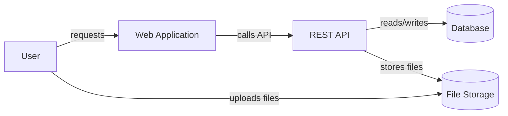
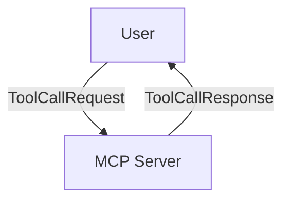

# TITULO

This example shows a simple architecture:
- User interacts with the web app
- Web app sends requests to the API
- API reads and writes data in the database
- API stores uploaded files in file storage
- The user can also upload directly to storage when needed

# Architect - lab 2.1
- The objective of this lab is test the creation of models based on Pydantic to answer client questions with a structured output schema
