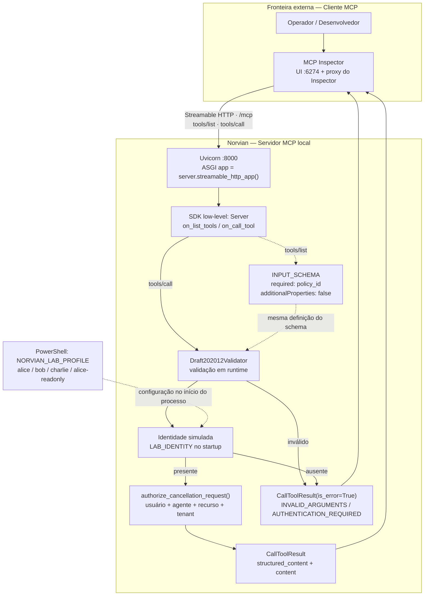
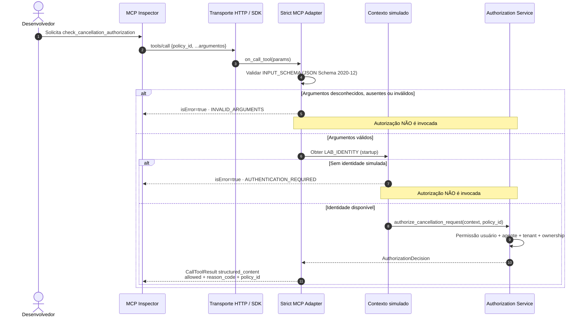

# Norvian Customer MCP Server — Arquitetura MCP-CONTRACT-001

**Programa:** MASTERING MCP · Semana 2 · Aula 2.2  
**Laboratório:** MCP-CONTRACT-001 — Root-Level Strict Input Validation  
**SDK utilizado nos testes:** Python MCP SDK v2.3.0  
**Escopo:** ferramenta `check_cancellation_authorization` (somente consulta; não cancela apólices)

## 1. Visão geral

O laboratório utiliza um **MCP Server low-level** que publica um contrato de entrada estrito e valida os argumentos antes de invocar os serviços de autorização do domínio. O **MCP Inspector** funciona como um cliente MCP independente e conecta-se via **Streamable HTTP** ao servidor ASGI servido por **Uvicorn**.



> **Importante:** `NORVIAN_LAB_PROFILE` é uma fixture de laboratório, **não autenticação real**. Todas as chamadas atendidas pela instância compartilham o contexto simulado fixado na inicialização. O Inspector e os argumentos de `tools/call` não devem ser fontes autoritativas de identidade.

## 2. Fluxo de uma chamada `tools/call`



**Duas defesas independentes:**

1. **Validação estrutural:** `additionalProperties: false` é publicado em `tools/list` e aplicado durante `tools/call` pelo `Draft202012Validator`. O schema, sozinho, não garante validação em runtime.
2. **Autorização de domínio:** mesmo com argumentos válidos, `authorize_cancellation_request()` verifica permissões do principal e do agente, delegação já estabelecida, tenant e autoridade sobre a apólice. Argumentos extras não podem mudar a identidade efetiva.

## 3. Contrato público e fronteiras de confiança

### Entrada MCP publicada

```json
{
  "type": "object",
  "properties": {
    "policy_id": {
      "type": "string",
      "pattern": "^POL-[0-9]{3}$"
    }
  },
  "required": ["policy_id"],
  "additionalProperties": false
}
```

### Exemplo de argumento rejeitado

```json
{
  "policy_id": "POL-001",
  "user_id": "alice",
  "agent_id": "insurance-agent",
  "is_admin": true
}
```

O adaptador retorna `INVALID_ARGUMENTS` **antes** de chamar o serviço de autorização. Os identificadores ou privilégios declarados livremente pelo cliente não substituem identidade e delegação estabelecidas por uma autoridade confiável.

### Saída de autorização (chamada válida)

```json
{
  "allowed": false,
  "reason_code": "RESOURCE_NOT_ACCESSIBLE",
  "policy_id": "POL-001"
}
```

Este resultado é esperado para Bob consultando `POL-001`, que pertence a Alice, no conjunto de dados simulado. **Não é um cancelamento** e não altera a apólice.

## 4. Estrutura de arquivos envolvida

```text
norvian-mcp-lab/
├── week2/  (ou week2_lab22/, conforme a estrutura local)
│   ├── week2_lab222_authorization.py
│   └── week2_lab22_contract001_strict_server.py
└── test/
    └── week2_lab22_contract001_test.py
```

- `week2_lab222_authorization.py`: fixtures de identidades, delegações e apólices; `build_trusted_context()` e `authorize_cancellation_request()`.
- `week2_lab22_contract001_strict_server.py`: servidor low-level, schemas, validação estrita, adaptador de respostas e aplicação ASGI.
- `week2_lab22_contract001_test.py`: testes de publicação do schema, argumentos inválidos e autorização.

> Ajuste os imports de acordo com o pacote real (`week2`, `week2_lab22` etc.). O traceback local mais recente indicou `week2_lab22/` e `test/`.

## 5. Como executar o Inspector sem `mcp dev`

**PowerShell — terminal 1: servidor**

```powershell
$env:NORVIAN_LAB_PROFILE = "bob"
uv run uvicorn week2_lab22.week2_lab22_contract001_strict_server:app --host 127.0.0.1 --port 8000
```

Se o módulo estiver no pacote `week2`, substitua `week2_lab22` por `week2` no caminho do Uvicorn.

**PowerShell — terminal 2: Inspector**

```powershell
npx @modelcontextprotocol/inspector
```

No navegador, abra o endereço exibido pelo Inspector (geralmente `http://localhost:6274`, usando o token indicado pelo processo quando aplicável). Configure:

| Configuração | Valor |
|---|---|
| Transport | Streamable HTTP |
| Server URL | `http://127.0.0.1:8000/mcp` |
| Ferramenta | `check_cancellation_authorization` |
| Argumento | `{"policy_id":"POL-001"}` |
| Resultado esperado para Bob | `allowed: false`, `reason_code: RESOURCE_NOT_ACCESSIBLE` |

O Inspector é iniciado **separadamente** do servidor. Ele realiza o processo de conexão exigido pelo transporte; não é necessário iniciar uma sessão com `mcp dev`.

> Abrir `/mcp` diretamente em uma aba do navegador não equivale a uma conexão MCP válida. Uma resposta como `Bad Request: Missing session ID` nesse acesso isolado não significa, por si só, que a integração com o Inspector esteja quebrada.

## 6. Evidências de teste

Resultados reportados no projeto:

| Teste | Objetivo | Resultado |
|---|---|---|
| 01 | `inputSchema` estrito publicado | PASS |
| 02 | Chamada válida de Alice | PASS |
| 03 | Argumentos extras rejeitados antes da autorização | PASS |
| 04 | Campo obrigatório ausente | PASS |
| 05 | Tipo incorreto de `policy_id` | PASS |
| 06 | Bob continua negado | PASS |
| 07 | Ausência de identidade tratada sem invocar autorização | PASS após correção |

**Execução da suíte:** `7/7 PASSED`. A conexão com o Inspector também foi reportada como funcional. A lista completa das mensagens HTTP do Inspector não foi anexada; portanto, os testes automatizados são a evidência explícita disponível da rejeição estrita.

## 7. Limites e próximos critérios

- O **adaptador low-level** demonstrou publicação e aplicação de schema estrito para esta ferramenta. Isso **não** modifica automaticamente o comportamento do `MCPServer` high-level utilizado em laboratórios anteriores.
- O perfil por variável de ambiente não autentica uma pessoa ou um agente e não isola usuários simultâneos. Não utilizar esse mecanismo em produção.
- Falhas de autenticação são retornadas como `CallToolResult(is_error=True)` neste desenho; a escolha entre erro de ferramenta e erro de protocolo deve ser documentada caso a arquitetura evolua.
- A lógica de cancelamento, aprovação humana, auditoria persistente e idempotência **não fazem parte deste adaptador**.
- Antes de consolidar a arquitetura de produção, decidir como aplicar a validação estrita a todas as ferramentas relevantes e como estabelecer identidade por requisição.

**Situação:** MCP-CONTRACT-001 validada para a ferramenta low-level do laboratório, com suíte automatizada `7/7`. O Incremento 3 (Secure Cancellation Workflow) permanece separado e ainda não começou.
