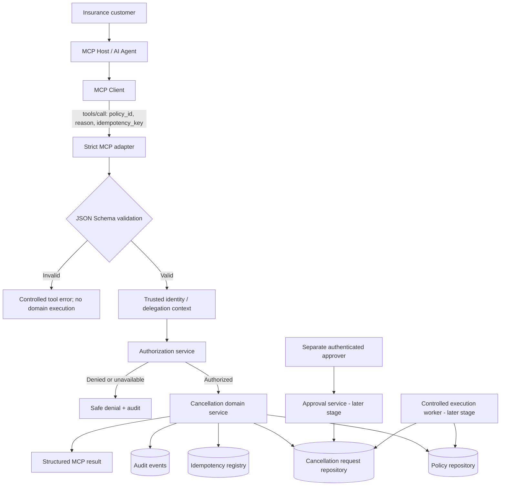
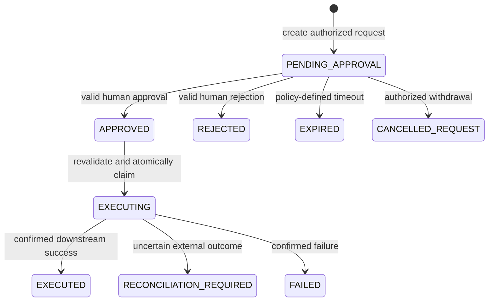

# MASTERING MCP — Week 2, Lesson 2.2 — Secure Cancellation Workflow

> **Repository folder:** `week2_lab3/`  
> **Document:** `week2_lab3/ARCHITECTURE.md`  
> **Status:** Architecture baseline approved in Increment 3A; Increment 3B implementation **not started**  
> **Target environment:** Python, MCP Python SDK **v2.3.0**, Pydantic v2, pytest, `uv`, Windows/PowerShell, MCP Inspector  
> **Domain:** Fictional insurance system — Norvian Customer MCP Server

## 1. Purpose and scope

This document defines the proposed architecture for a **secure, auditable insurance policy cancellation-request workflow** implemented through an MCP tool:

```python
request_policy_cancellation(
    policy_id: str,
    reason: str,
    idempotency_key: str,
)
```

**The tool records a cancellation request; it does not cancel the policy.** Actual policy cancellation requires a separate, controlled approval-and-execution workflow. The initial increment uses **in-memory repositories and simulated trusted identities**; OAuth, databases and cloud infrastructure are out of scope unless later justified.

This architecture follows the prior laboratories on context injection, delegated and object-level authorization, and strict root-level input validation. The `MCP-CONTRACT-001` fix was validated **for the low-level adapter**; it does not automatically apply to other high-level `MCPServer` tools.

### 1.1 In scope for Increment 3B

- Internal domain models for `Policy`, `CancellationRequest`, `ApprovalRecord`, `AuditEvent`, and idempotency records.
- Creation of cancellation requests with explicit permission checks and business validation.
- Idempotent request creation, including safe handling of concurrent retries in **one process**.
- Explicit, testable workflow state transitions and protection against invalid transitions.
- Minimal audit events for allowed, denied, duplicate, conflicting and failed attempts.
- Automated domain/service tests, including concurrency and fail-closed cases.

### 1.2 Planned follow-on integration and extensions

- **Increment 3C:** expose `request_policy_cancellation` through MCP using an adapter that enforces an exact public `inputSchema` at runtime; inspect `tools/list` and `tools/call`.
- Later workflow steps: an authenticated approval interface, safe execution against the policy system, retries/reconciliation, and authorization refresh at execution. These are **architecturally designed here**, not assumed to be delivered in the first 3B implementation.
- Production alternatives: authenticated request-level identity, durable transactions/constraints, secure audit persistence, external execution idempotency, authorization/policy services, and cryptographic integrity where warranted.

## 2. Requirements and security properties

The system shall:

1. Separate **request**, **approval**, and **execution** authorities.
2. Reject unknown MCP arguments before invoking domain code; continue checking authorization for otherwise valid arguments.
3. Obtain `principal_id`, verified agent/delegation information, permissions and tenant from a **server-controlled, request-bound trust context**, never from free-form tool arguments or unverified `_meta`.
4. Enforce permission for the principal, permission and delegation for the agent, object-level authority over the policy, and tenant isolation.
5. Deny when identity, required authorization, policy state, or other required conditions cannot be established (**fail closed**).
6. Keep `Policy.status == ACTIVE` after creating a `CancellationRequest`.
7. Associate retries with their original logical operation, without treating an idempotency key as authorization.
8. Prevent concurrent processes/threads from independently claiming the same request in the supported deployment model.
9. Persist or record auditable evidence of material decisions and state transitions without logging unnecessary personal data.
10. Never infer successful external cancellation merely from the absence of an error/response.

## 3. System context and trust boundaries



**TB1 — Client to MCP adapter:** Tool arguments and `_meta` are untrusted. Declared identifiers such as `policy_id` describe a requested target, **not** a security principal.

**TB2 — MCP adapter to authorization/domain:** The trusted identity provider or test harness establishes a context outside the LLM-controlled argument map. Context type checking alone does not authenticate anyone.

**TB3 — Workflow to policy/external insurance system:** Server credentials may exceed an end-user's scope. Re-check delegated and object authorization; avoid the *confused deputy* problem. Approval is not execution authority.

**TB4 — Approver to approval system:** Only an authenticated, authorized approver can record a decision. The agent cannot set `approved_by`, `approved_at` or `APPROVED` via the cancellation-request tool.

**TB5 — Storage and auditing:** Repositories must preserve isolation, uniqueness, state integrity, and evidence; in-memory guarantees are valid **only within their test-process scope**.

## 4. Architecture components and responsibilities

| Component | Responsibility | Explicit non-responsibility |
|---|---|---|
| `StrictMCPAdapter` | Publish `inputSchema`/`outputSchema`, reject unknown or invalid arguments, map results and errors | Grant identity or business authorization |
| `TrustedIdentityProvider` (simulated) | Supply a trusted-context fixture for a controlled lab invocation | Authenticate real external users or agents |
| `AuthorizationService` | Principal + agent + delegation + tenant + object-level checks | Approve or execute a cancellation |
| `CancellationService` | Validate business eligibility, enforce idempotency, create requests, manage allowed transitions | Accept client-supplied authorization decisions |
| `PolicyRepository` | Read current policy data/version with tenant scoping | Decide agent authorization |
| `CancellationRequestRepository` | Store requests and perform atomic state/uniqueness operations | Treat a prior approval as permanently sufficient |
| `IdempotencyRegistry` | Bind a scoped key to fingerprint and stable result | Replace business uniqueness or authorization |
| `ApprovalService` (later stage) | Accept authenticated human decision, bind to one request and version | Allow a tool parameter to assert approval |
| `ExecutionService` (later stage) | Revalidate, acquire atomic execution claim, invoke policy system, reconcile outcomes | Blindly retry unknown external outcomes |
| `AuditRecorder` | Record relevant attempts, decisions, state changes and correlation IDs | Expose sensitive audit details to an MCP client |

### 4.1 Dependency direction

```text
MCP Adapter -> CancellationService -> Repositories
            -> AuthorizationService -> PolicyRepository
            -> AuditRecorder
```

The domain/service layer must be testable **without MCP transport or Inspector**. Existing `week2_lab222_authorization.py` can be reused rather than rewritten, with isolated additions as needed.

## 5. Public tool contract

### 5.1 Input (LLM-controlled, validated)

```json
{
  "type": "object",
  "properties": {
    "policy_id": {
      "type": "string",
      "pattern": "^POL-[0-9]{3}$"
    },
    "reason": {
      "type": "string",
      "minLength": 1,
      "maxLength": 1000
    },
    "idempotency_key": {
      "type": "string",
      "minLength": 1,
      "maxLength": 128
    }
  },
  "required": ["policy_id", "reason", "idempotency_key"],
  "additionalProperties": false
}
```

`reason` limits and idempotency-key bounds are **proposed application constraints**, not MCP protocol requirements; finalize them before implementation. Validate the same schema in `tools/call` **before** domain logic. Do not rely exclusively on `tools/list` publication or on high-level SDK model defaults.

**Do not expose as authoritative tool inputs:** `user_id`, `principal_id`, `agent_id`, `tenant_id`, `permissions`, `is_admin`, `approval_status`, `approved_by`, or `status`.

### 5.2 Proposed structured output

```json
{
  "request_id": "REQ-1001",
  "policy_id": "POL-001",
  "status": "PENDING_APPROVAL",
  "created": true,
  "reason_code": "REQUEST_CREATED"
}
```

For the same idempotency key and same canonical request, return the stable existing request and indicate that no new request was created. A conflicting reuse should be a controlled error (e.g., `IDEMPOTENCY_CONFLICT`). Authorization denials should expose non-sensitive reason codes such as `RESOURCE_NOT_ACCESSIBLE`; more detailed reasons may go to protected audit logs.

**Output semantics and the exact `isError`/`structuredContent` envelope will be verified during MCP integration**, rather than assumed from the domain model.

## 6. Proposed domain models

### 6.1 `Policy`

| Field | Type | Notes |
|---|---|---|
| `policy_id` | string | Unique policy identifier |
| `owner_id` | string | Owner (simplified lab relationship) |
| `tenant_id` | string | Data-isolation scope |
| `status` | `ACTIVE \| CANCELLED` | Existing fictional domain model |
| `version` | positive integer | Optimistic concurrency control |

### 6.2 `CancellationRequest`

| Field | Type | Provenance |
|---|---|---|
| `request_id` | string | Server-generated |
| `policy_id` | string | Validated tool input |
| `reason` | string | Validated tool input |
| `requested_by` | string | Trusted principal context |
| `agent_id` | string | Verified/simulated agent binding |
| `tenant_id` | string | Trusted tenant context |
| `idempotency_key` | string | Tool input, scoped on server |
| `request_fingerprint` | string | Hash of canonical operation/arguments |
| `status` | `CancellationStatus` | Domain-controlled |
| `policy_version_at_request` | integer | Snapshot for later revalidation |
| `created_at`, `updated_at` | UTC timestamps | Server-generated |
| `version` | integer | Concurrency counter |
| `approved_by`, `approved_at` | nullable | Only approval service fills |

### 6.3 `ApprovalRecord` (designed, future execution)

- `approval_id`, `request_id`, `approver_id`, `decision`, `decided_at`
- `request_fingerprint`, `policy_version`, `approval_policy_version`
- Recorded only after authenticating/authorizing the approver.
- Server-stored approval is bound to **one specific request**, not to a generic policy or agent-provided claim.
- A plain hash is **not** evidence of approver identity; cryptographic protection (e.g., server-held HMAC/signature) is a separate design decision if required by the threat model.

### 6.4 `IdempotencyRecord`

- Scope tuple: `(tenant_id, principal_id, agent_id, operation, idempotency_key)` — provisional policy; validate required scope in implementation.
- `request_fingerprint` over a **canonical representation** of relevant operation arguments.
- `request_id`, `stored_result` or stable reference, timestamps and retention/expiry policy.
- Never use key possession as a permission grant.

### 6.5 `AuditEvent`

- `event_id`, `timestamp_utc`, `correlation_id`
- `principal_id`, `agent_id`, `tenant_id` (if established)
- `operation`, `resource_id`, `request_id` (where applicable)
- `decision`, `reason_code`, `state_before`, `state_after`
- Optional `policy_version`, `request_version`, `policy_rule_version`
- No unredacted tokens, credentials or excessive PII.

## 7. Workflow state machine

### 7.1 States

| State | Meaning |
|---|---|
| `PENDING_APPROVAL` | Authorized request recorded; no policy cancellation |
| `APPROVED` | Human approval recorded; still not executed |
| `REJECTED` | Human rejected the request |
| `EXECUTING` | Execution exclusively claimed and in progress |
| `EXECUTED` | Policy system confirmed cancellation |
| `FAILED` | Defined unsuccessful outcome; retriability must be explicit |
| `EXPIRED` | Approval/request no longer eligible within policy window |
| `CANCELLED_REQUEST` | Request withdrawn; **not** policy cancellation |
| `RECONCILIATION_REQUIRED` *(candidate)* | External outcome uncertain; do not blindly repeat |

The final representation of `FAILED` and the separate `RECONCILIATION_REQUIRED` state remains an **open design choice**, not an approved implementation decision.

### 7.2 Allowed transitions (baseline)



**Forbidden:** client-directed `APPROVED`, `PENDING_APPROVAL -> EXECUTED`, `REJECTED -> EXECUTED`, and re-executing an `EXECUTED` request. Further transitions require explicit review.

### 7.3 Execution-time revalidation

An approval **does not** automatically authorize execution forever. Before `APPROVED -> EXECUTING`, check the current policy status and version, applicable business rules, authorization/revocation policies, valid approval association and execution prerequisites. An approver losing authority **after** approving does not necessarily invalidate past approvals; that is a business/security policy decision.

## 8. Security invariants

| ID | Invariant | Planned verification |
|---|---|---|
| INV-01 | Creating a request never sets `Policy.status = CANCELLED` | State snapshot test |
| INV-02 | Only an authenticated, authorized user/agent can create a request for the policy | Auth matrix tests |
| INV-03 | Agent-provided input cannot set approval or internal identities | Strict input tests |
| INV-04 | Rejected/expired/withdrawn requests cannot be executed | Transition tests |
| INV-05 | Business eligibility and required authorization are rechecked when execution is claimed | TOCTOU tests (later) |
| INV-06 | Identical retries do not create duplicate logical requests | Idempotency tests |
| INV-07 | Concurrent state claims preserve exclusivity | Atomicity stress tests |
| INV-08 | Material decisions/transitions are auditable | Audit assertions |
| INV-09 | Unavailable identity/authorization causes no operation | Fail-closed tests |
| INV-10 | Unknown downstream effect cannot be retried as if definitely failed | Reconciliation tests (later) |

## 9. Idempotency and business uniqueness

**Idempotency** and **one-active-request-per-policy** are distinct requirements.

| Scenario | Expected outcome |
|---|---|
| Same scoped key + same fingerprint | Return existing request/result; do not create another |
| Same scoped key + different fingerprint | Reject with `IDEMPOTENCY_CONFLICT` |
| Different key + same policy while an active request exists | Apply explicit business uniqueness policy; do **not** mistake for a retry |
| Same key arriving concurrently | Exactly one registry insertion/request creation in supported single-process setup |
| Request completed; original key retried | Return stable previous result as retained by idempotency policy; do not repeat action |

A canonical fingerprint may use a deterministic representation of `operation`, `policy_id`, normalized `reason`, and other relevant fields. Define normalization explicitly; hash equality **is not** a security credential. Reauthorize requests appropriately before disclosing stored results: an idempotency hit must not become an information-disclosure path.

**Proposed lab rule:** at most one non-terminal cancellation request for a given `(tenant_id, policy_id)` at a time, enforced atomically; this is independent of idempotency.

### Concurrency approach

- **In memory, one process:** protect check + insert and conditional transitions using a shared lock around the critical section; tests should exercise simultaneous calls. No lock should be held across slow external calls.
- **Production, multiple processes:** transactional unique constraints/indexes, compare-and-swap or conditional updates with row-version predicates, plus idempotent downstream handling. A single-process mutex is insufficient.
- **External execution:** atomic claiming does not itself guarantee exactly-once effects after timeouts; reconcile with downstream execution identifiers/receipts or idempotency support.

## 10. Threat model and mitigations

| Threat | Example | Control |
|---|---|---|
| Parameter smuggling | Extra `is_admin=true` | Exact public schema and runtime validation |
| Identity spoofing | Client sends `user_id="alice"` | Context verified outside agent arguments |
| Confused deputy | Server-wide privilege used for Bob's request | User/agent/delegation/object/tenant checks |
| BOLA | Bob requests Alice's policy | Object-level authorization |
| Cross-tenant access | `TENANT-A` accesses `TENANT-B` | Tenant scoping in policy retrieval and authorization |
| Prompt injection | Untrusted policy notes demand approval | Treat tool/resource content as data, not instructions |
| Approval forgery/reuse | Agent claims `APPROVED` | Separate authenticated approval service, bound approval record |
| Duplicate/replayed requests | Retried `tools/call` | Scoped idempotency key and atomic registry |
| TOCTOU | Policy changed after approval | Revalidation and atomic state/conditional writes |
| Double execution | Two workers claim `APPROVED` | Atomic claim and external reconciliation |
| Audit gaps | Denial omitted | Consistent audit event on decisions/errors |
| Authorization outage | Policy service unavailable | Fail closed with distinct error semantics |

## 11. Error handling and observability

Distinguish these categories:

1. **Protocol/contract error:** missing/extra/wrong-type input; controlled tool validation failure before business logic.
2. **Authentication unavailable/absent:** refuse request; no fallback identity.
3. **Authorization denied:** generic client-facing denial, detailed protected audit code.
4. **Business rejection:** policy not eligible, duplicate active request or invalid transition.
5. **Idempotency conflict:** same scoped key used with different canonical input.
6. **Transient infrastructure problem:** fail closed when a required check or storage guarantee cannot be established.
7. **Uncertain external outcome:** quarantine/reconcile; not a safe automatic retry.

Record a stable `correlation_id` and distinguish `DENIED` from `UNAVAILABLE` and `INVALID_ARGUMENTS`. Do not claim a state transition in the audit trail before it is committed. For production durable storage, coordinate the state mutation and event persistence transactionally or through a reliable outbox strategy.

## 12. Repository layout

The user-selected GitHub folder name is **`week2_lab3`**. Proposed incremental layout:

```text
week2_lab3/
├── ARCHITECTURE.md
├── week2_lab3_security_models.py
├── week2_lab3_cancellation_repository.py
├── week2_lab3_idempotency.py
├── week2_lab3_audit.py
├── week2_lab3_cancellation_service.py
├── week2_lab3_mcp_server.py          # Increment 3C
└── tests/
    ├── test_cancellation_service.py
    ├── test_idempotency_concurrency.py
    ├── test_state_machine.py
    └── test_mcp_contract.py           # Increment 3C
```

Existing authorization and strict-contract lab modules remain in their current locations. Prefer import/reuse (or carefully extract a common module) over copying and diverging. The structure above is **planned**; only this `ARCHITECTURE.md` is being delivered now.

## 13. Implementation roadmap

### Increment 3A — Architecture baseline (**completed**)

- Domain boundaries, state-machine proposal, security invariants and threat modeling reviewed.
- Remaining design decisions explicitly tracked below.

### Increment 3B — Domain logic and automated tests (**next; not started**)

1. Implement immutable/validated domain models and state definitions.
2. Implement in-memory repositories with atomic operation scope.
3. Reuse trusted context and authorization service from previous lab.
4. Implement request eligibility + creation without policy cancellation.
5. Implement scoped idempotency and fingerprint conflict detection.
6. Implement audit events for creations, denials and conflicts.
7. Test permitted and forbidden transitions; concurrency and rollback/failure behavior.

### Increment 3C — MCP integration (**not started**)

1. Expose `request_policy_cancellation` with strict input contract.
2. Ensure runtime rejection occurs before the service.
3. Bind request-specific trusted identity (lab simulation only).
4. Validate MCP `tools/list`, `tools/call` and structured results in Inspector.
5. Run regression tests preserving authorization and existing contracts.

### Later controlled execution (**not in initial 3B scope**)

- Human approval and rejection UI/service, approval evidence.
- Approved-to-executing atomic claim and revalidation.
- Downstream policy cancellation, outcome reconciliation, timeouts and compensating/business handling as necessary.

## 14. Test plan and acceptance criteria

| Test | Expected behavior | Stage |
|---|---|---|
| Alice creates request for active own policy | One `PENDING_APPROVAL`; policy remains `ACTIVE` | 3B |
| Bob targets Alice's policy | Denied; no request created | 3B |
| Read-only agent targets Alice's policy | Denied | 3B |
| Unknown identity / unavailable authorization | Denied/fail-closed; no mutation | 3B |
| Cross-tenant policy | Not accessible | 3B |
| Same key + same fingerprint repeated | Original request returned; no duplicate | 3B |
| Same key + changed arguments | Conflict | 3B |
| Two simultaneous identical requests | Exactly one logical request | 3B |
| Different key, same policy, active request | Explicit business uniqueness rule enforced | 3B |
| Invalid transition | Rejected without state change | 3B |
| Sensitive decision | Appropriate audit record | 3B |
| Unknown fields in MCP tool input | Rejected before domain logic | 3C |
| Output schema and tool execution | Discoverable/valid via Inspector | 3C |
| Revoked authority or changed policy before execution | No unauthorized execution | Later |
| Unknown downstream execution result | Reconciliation, not blind retry | Later |

**Increment 3B approval gate:** required 3B test cases pass; no unauthorized/duplicate request creation; no premature cancellation; in-memory concurrency guarantees demonstrated; limitations documented. This does **not** constitute production security certification.

## 15. Open architecture decisions

The following choices are **not yet finalized**, and should be made explicitly before/during 3B:

1. Exact normalization and maximum length for `reason` and `idempotency_key`.
2. Idempotency retention/expiration and replay behavior after retention.
3. Whether request creation may occur for a policy with other non-terminal request states (proposed deny/return conflict).
4. Whether `REQUESTED` is a persisted state or merely a transient step before `PENDING_APPROVAL` (current baseline omits it).
5. State semantics for `FAILED` versus `RECONCILIATION_REQUIRED`, including recoverable outcomes.
6. Which revocations or business-rule updates invalidate an already recorded approval.
7. Audit retention and tamper protection appropriate to real regulatory requirements.
8. Authentication/delegation design for per-request, multi-user, multi-instance production deployment.
9. How the exact root-level validation contract will be reused by any high-level `MCPServer` tools.

## 16. References and provenance

This architecture is derived from the **MASTERING MCP** exercises and decisions in Week 2, Lesson 2.2, including:

- Lab 2.2.1 — Context Injection, authentication claims versus verified identities.
- Lab 2.2.2 — Trusted Identity, Delegated Authorization, Object-Level Authorization.
- `MCP-CONTRACT-001` — Strict root-level JSON Schema validation, verified with seven automated tests and MCP Inspector for the low-level adapter.
- Increment 3A — State Integrity, Idempotency, Human Approval and Concurrent Execution design review (8.5/10).

Official technical references for the eventual implementation:

- [MCP Specification](https://modelcontextprotocol.io/specification)
- [MCP Python SDK](https://github.com/modelcontextprotocol/python-sdk)
- [Linux Foundation MCPA](https://training.linuxfoundation.org/certification/model-context-protocol-associate-mcpa/)

> **Architecture principle:** The agent can express an intent, but it cannot grant itself identity, permissions, approval, or execution authority. Every side effect must be justified by server-enforced policy and preserved by an atomic state transition.
